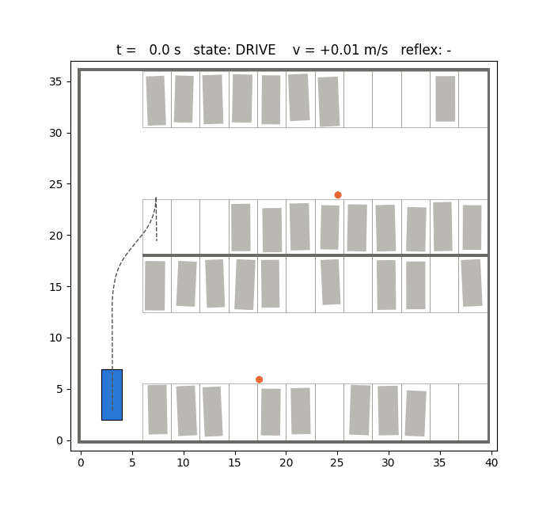
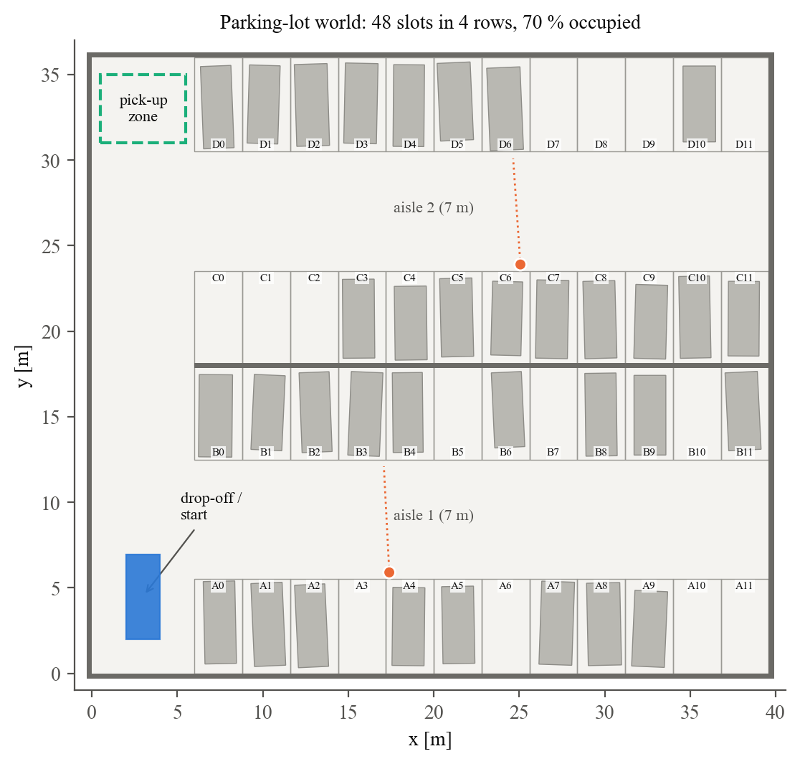
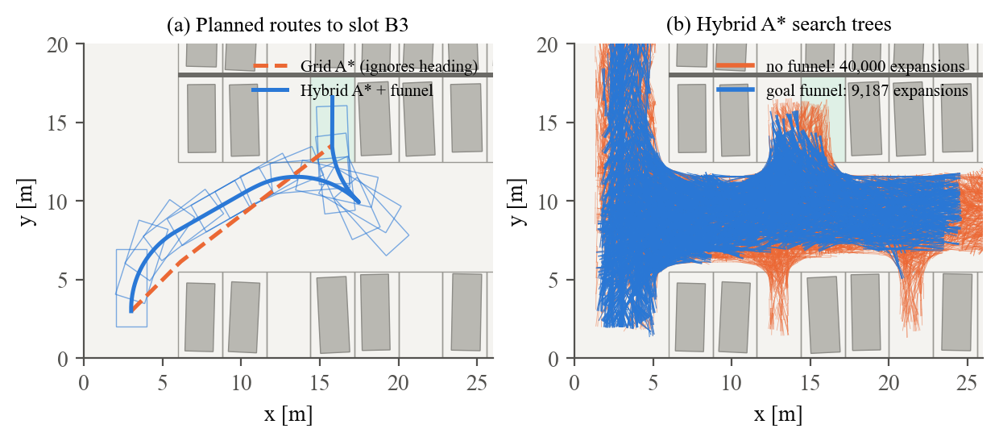
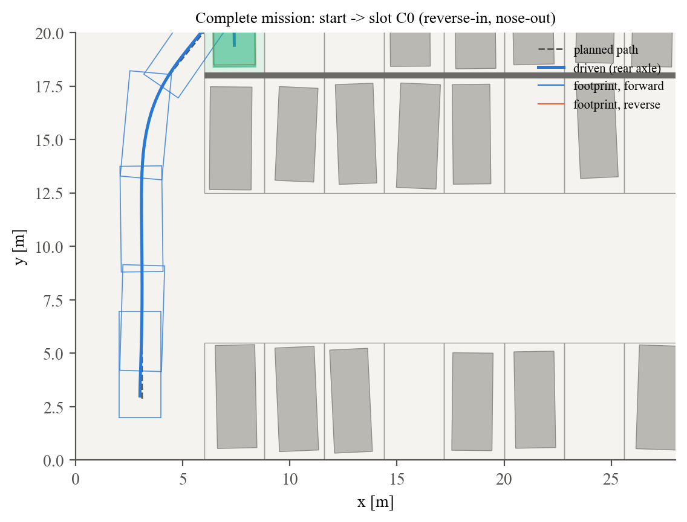

# Autonomous Valet Parking Agent


[](https://github.com/AnirvanRanjan/g14-valet-parking/actions/workflows/ci.yml)

**An autonomous parking system combining Hybrid A\* motion planning, closed-loop vehicle control, utility-based slot selection, and reflexive pedestrian safety in Webots.**

The system controls a car-like **Ackermann vehicle** through a 48-slot parking environment. It selects a suitable free slot, generates a kinematically feasible route, follows the planned trajectory, reverses into the target slot nose-out, and continuously monitors its surroundings for collision risk.

The agent follows the **declarative → procedural → reflexive** hierarchy:

```text
DECIDE  →  PLAN  →  DRIVE  →  REACT  →  PARK
   │         │        │         │         │
 Slot     Hybrid    Path      Safety    Final
select.     A*      control    layer     pose
```

> **Academic Project:** P13, Group G14 · CSAI4014 Algorithms for Intelligent Systems and Robotics · B.Tech CSE (AI & ML), Semester VII, Batch B2 · UPES

## Team

| Member | SAP ID | Primary contribution |
| --- | --- | --- |
| Saurabh Kumar | 500124288 | Lot model, Webots world and controller — `valet/lot.py`, `valet/costmap.py`, `tools/make_world.py`, `controllers/valet_parking/` |
| Naman Chanana | 500119485 | Deliberative planners — `valet/planning/hybrid_astar.py`, `valet/planning/grid_astar.py`, `valet/planning/path.py` |
| Anirvan Ranjan | 500119330 | Agent architecture, slot-selection utility, mission FSM and localisation — `valet/agent.py`, `valet/slot_selection.py`, `valet/localisation.py` |
| Aditya Pratap Singh Sisodia | 500121985 | Procedural control — Pure Pursuit, Stanley, PID, speed profile and tracker in `valet/control/` |
| Priyal Sharma | 500122041 | Reflexive layer, simulator twin and experiments — `valet/reflex.py`, `sim/`, `experiments/` |

## Key Features

- **Hybrid A\*** motion planning for car-like vehicle constraints
- **Pure Pursuit / Stanley** path tracking with PID speed control
- Utility-based parking-slot selection
- Three-layer **declarative–procedural–reflexive** agent architecture
- Swept-footprint time-to-collision pedestrian safety
- GPS + odometry Kalman-filter localisation
- Mission FSM with re-selection and re-planning
- Headless simulation twin for reproducible experiments
- Webots integration with generated parking scenarios
- Automated unit and integration test suite

## Project Resources

| Resource | Description |
| --- | --- |
| [`results/summary.md`](results/summary.md) | Experimental results and performance summary |
| [`results/`](results/) | Raw results, generated figures and tables |
| [`report/`](report/) | Full project report and technical analysis |
| [`slides/`](slides/) | Project presentation material |
| [`docs/`](docs/) | Meeting notes, viva preparation and supporting documentation |
| [`experiments/`](experiments/) | Reproducible Monte Carlo experiment pipeline |
| [`sim/`](sim/) | Headless simulation twin and demo runner |
| [`tests/`](tests/) | Unit and integration test suite |

## Demo

<p align="center">
  
</p>

<p align="center">
  <i>End-to-end parking mission in the headless simulation twin: slot selection, Hybrid A* planning, path tracking, docking and parking.</i>
</p>

The demo can be reproduced with:

```bash
python sim/run_demo.py --seed 3 --pedestrians 2
```

## Architecture

The system is organized as a three-layer autonomous agent. Higher layers make deliberate mission-level decisions, while lower layers operate at progressively faster rates and can override higher-level commands when safety requires it.

| Layer | Responsibility | Core components |
| --- | --- | --- |
| **Declarative** | Decide where to park and generate a feasible route | Utility-based slot selection, Hybrid A*, Grid A* baseline, goal funnel |
| **Procedural** | Convert the planned path into steering and speed commands | Pure Pursuit, Stanley controller, speed profile, PID, cusp handling |
| **Reflexive** | React immediately to local hazards and docking conditions | Emergency stop, swept-footprint TTC, docking logic, blocked-path detection |

### System Flow

```text
                 ┌──────────────────────┐
                 │      ValetAgent      │
                 │    valet/agent.py    │
                 └──────────┬───────────┘
                            │
          GPS · IMU · wheel speed · range sensors
                            │
                            ▼
                 ┌──────────────────────┐
                 │     Localisation     │
                 │    Kalman Filter     │
                 └──────────┬───────────┘
                            │
                            ▼
┌─────────────────────────────────────────────────┐
│ DECLARATIVE                                     │
│ Slot Selection → Hybrid A* → Goal Funnel       │
│ Re-select / re-plan when conditions change      │
└──────────────────────┬──────────────────────────┘
                       │ planned path
                       ▼
┌─────────────────────────────────────────────────┐
│ PROCEDURAL                                      │
│ Pure Pursuit / Stanley → Speed Profile → PID   │
│ Path tracking · steering · cusp handling        │
└──────────────────────┬──────────────────────────┘
                       │ motion command
                       ▼
┌─────────────────────────────────────────────────┐
│ REFLEXIVE                                       │
│ R1 E-stop · R2 TTC · R3 Docking · R4 Blocked  │
│ Fast safety layer — overrides higher layers     │
└──────────────────────┬──────────────────────────┘
                       │
                       ▼
                 Steering + Speed
```


### Mission State Machine

```text
SELECT
   ↓
 PLAN ←──────────────┐
   ↓                 │
 DRIVE ── blocked ───┤
   ↓                 │
 DOCK                │
   ↓                 │
PARKED        slot unavailable
                     │
                     └──→ re-select / re-plan
```

## Quick Start

### 1. Install dependencies

```bash
pip install -r requirements.txt
```

### 2. Run the headless simulator

Run one animated parking mission:

```bash
python sim/run_demo.py --seed 3 --pedestrians 2
```

The generated animation is saved to:

```text
results/demo.gif
```

### 3. Run the test suite

Run the unit and integration tests:

```bash
python -m unittest discover -s tests -v
```

The test suite also includes the Webots controller running against a fake Driver.

### 4. Reproduce the experiments

Run the experiments used for the project report:

```bash
python experiments/run_experiments.py --n 30
python experiments/make_figures.py
```

The complete experiment suite takes approximately **15–25 minutes on an 8-core machine**.

### Running in Webots

Requires **Webots R2025a or newer**.

Generate the parking world:

```bash
python tools/make_world.py --seed 3 --occupancy 0.7 --pedestrians 1
```

Optional alternatives include:

```text
--planner grid
--law stanley
--reflex fixed
--selector nearest
```

Then open:

```text
worlds/valet_parking.wbt
```

in Webots and press **Run**.

The controller `controllers/valet_parking/valet_parking.py` prints mission states in the Webots console and writes CSV logs to:

```text
results/webots_runs/
```

Webots must use a Python 3.9+ interpreter with NumPy and SciPy installed:

**Webots → Preferences → Python command**

### Troubleshooting

- **Car turns the wrong way at the first bend:** add `"--steer-sign=1"` to `controllerArgs` in the world file. Webots uses positive = right; the agent uses positive = left.
- **`sensors reading ~0 m` warning:** the sensor may see the car's own body. Move it 3–5 cm outward in `valet/config.py` (`_sensor_layout`) and regenerate the world with `make_world.py`.
- **Car does not reverse in cruise mode:** run with `"--speed-mode=throttle"`, which uses gears and the project's PID controller for throttle and braking.


## Repository Structure

```text
g14-valet-parking/
│
├── valet/                       Core autonomous valet system
│   ├── planning/                Grid A*, Hybrid A*, goal funnel and Path
│   ├── control/                 PID, Pure Pursuit, Stanley and PathTracker
│   ├── agent.py                 Three-layer agent and mission FSM
│   ├── reflex.py                Reflexive safety layer (R1–R4)
│   ├── slot_selection.py        Utility and nearest-slot selection
│   ├── localisation.py          GPS + odometry Kalman filter
│   ├── costmap.py               Occupancy grid and footprint checking
│   └── lot.py                   Parking-lot and scenario model
│
├── controllers/
│   └── valet_parking/           Webots controller integration
│
├── sim/                         Headless simulation twin and demo
├── experiments/                 Monte Carlo experiments and figure generation
├── tests/                       Unit and integration test suite
├── tools/                       World-generation utilities
├── worlds/                      Generated Webots parking environment
│
├── results/
│   ├── figures/                 Experimental plots
│   ├── tables/                  Generated result tables
│   ├── webots_runs/             Webots execution logs
│   └── summary.md               Experiment summary
│
├── report/                      Full technical project report
├── slides/                      Presentation material
├── docs/                        Supporting project documentation
│
├── requirements.txt
└── README.md
```


## Results

The system was evaluated in the headless simulation twin across **30 random parking-lot scenarios per setting**, using fixed random seeds for reproducibility.

### Parking Environment

<p align="center">
  
</p>

### Planning Behaviour

<p align="center">
  
</p>

The planning experiments compare the trajectories generated by the available planning approaches in the shared parking environment.

### End-to-End Mission

<p align="center">
  
</p>

The complete mission combines slot selection, planning, path tracking, reflexive safety and final docking through the shared `ValetAgent`.

### Experimental Evaluation

The experiment suite evaluates multiple components of the system, including:

- planner behaviour and search performance
- reflexive safety behaviour
- localisation under sensor noise
- tracking and final parking error
- controller and mission-level performance

Detailed results are available in:

- [`results/summary.md`](results/summary.md) — experiment summary
- [`results/figures/`](results/figures/) — generated plots and visualisations
- [`results/tables/`](results/tables/) — generated result tables
- `results/experiments.csv` — raw experiment data
- [`report/`](report/) — complete project report and analysis

All experiments can be reproduced with:

```bash
python experiments/run_experiments.py --n 30
python experiments/make_figures.py
```

## References

The project design draws on established work in autonomous driving, motion planning, vehicle control and layered robotic architectures.

- D. Dolgov et al., **“Path Planning for Autonomous Vehicles in Unknown Semi-structured Environments,”** *The International Journal of Robotics Research*, 2010 — Hybrid A*.
- R. C. Coulter, **“Implementation of the Pure Pursuit Path Tracking Algorithm,”** Carnegie Mellon University, 1992 — Pure Pursuit.
- S. Thrun et al., **Stanley: The Robot that Won the DARPA Grand Challenge**, 2006 — Stanley steering controller.
- R. A. Brooks, **“A Robust Layered Control System for a Mobile Robot,”** 1986 — subsumption and reactive robotics.
- E. Gat, **“On Three-Layer Architectures,”** 1998 — layered autonomous-agent architecture.
- **ISO 23374-1:2023** — Automated valet parking systems.

The complete IEEE-formatted bibliography and technical discussion are available in the [`report/`](report/) directory.

---

<p align="center">
  <b>Autonomous Valet Parking Agent · Group G14</b><br>
  <sub>Planning · Control · Localisation · Reflexive Safety · Webots Simulation</sub>
</p>
